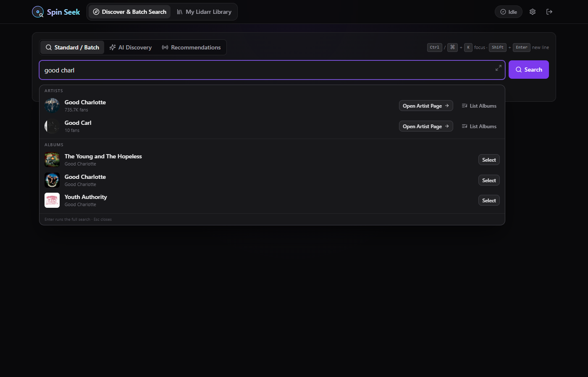
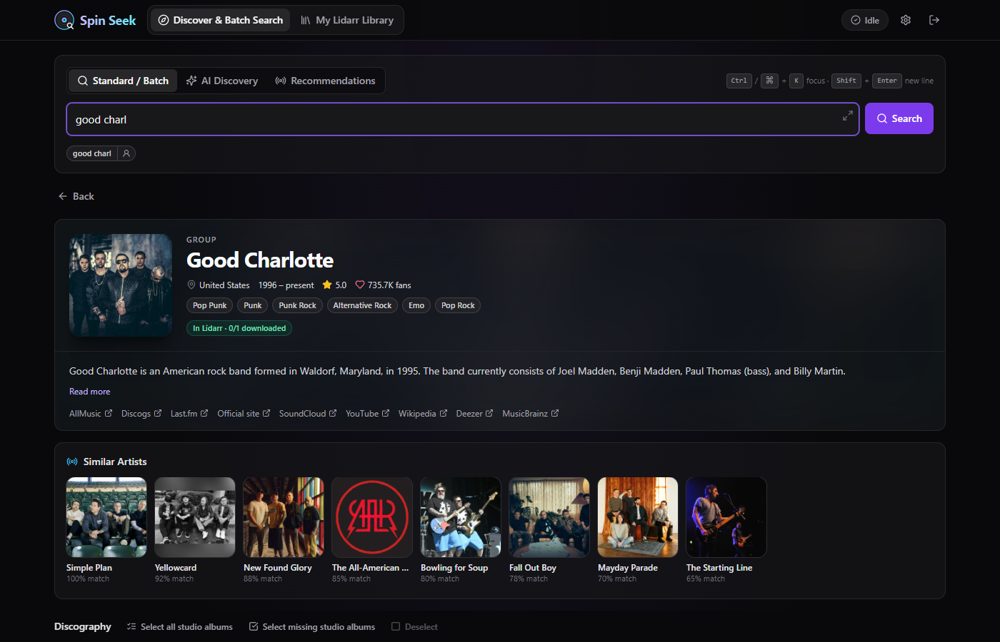
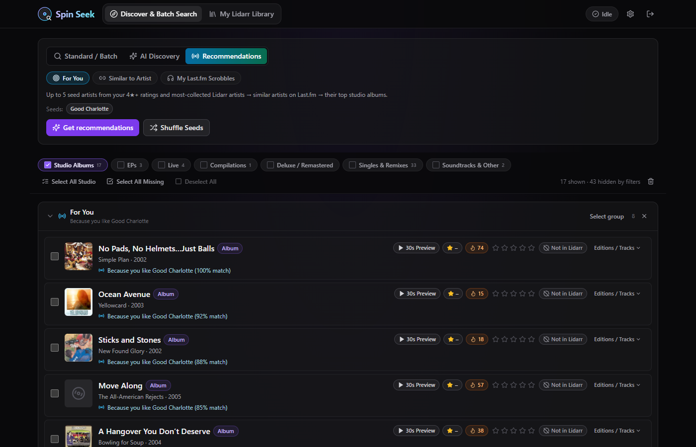

# Spin Seek

**Find music you'll love and get exactly the albums you want into Lidarr, without fighting Lidarr's search.**

Spin Seek is a self-hosted web app that sits next to [Lidarr](https://lidarr.audio). You can:

- **Search for anything:** type an artist, paste a list of albums, or ask for recommendations.
- **Pick before you download:** preview tracks, read ratings, and choose exactly which albums you want.
- **Send in one click:** the right album goes to Lidarr, as the normal edition rather than a random deluxe or Best Buy version, and gets searched safely without hammering your indexers.

It runs as one small Docker container (one port, one SQLite file) and is ready for Unraid.

| Search as you type | Artist pages | Recommendations |
| --- | --- | --- |
|  |  |  |

**Who it's for:** Lidarr users who are tired of adding a whole discography to get one album, getting the wrong edition, or wondering what to listen to next.

## Features

- **Discover & batch search**: type an artist, `Artist - Album`, or paste a list. Spin Seek resolves everything against MusicBrainz release groups and forgives typos ("radiohed - ok computr"). It collapses deluxe/remaster duplicates, and shows Lidarr status, community ratings, Deezer popularity and 30-second previews.
- **Standard editions**: when albums go to Lidarr, Spin Seek has Lidarr monitor the normal pressing: official, preferred country (default US), usual track count, single disc. It skips deluxe, store-exclusive (Best Buy, Target…), signed, clean and bonus-track variants. You can also pin a specific edition per album in the Editions drawer.
- **Live search**: suggestions appear as you type (top artists and albums). Each search pill is clickable, and any artist opens a full **artist page** (bio, similar artists, discography).
- **AI Discovery**: works with any OpenAI-compatible endpoint (OpenAI, Ollama, LM Studio, Open WebUI) or Google Gemini. Your 4★+ ratings shape the picks, your library is excluded, and every pick is verified on MusicBrainz.
- **📻 Recommendations (no AI needed)**: Last.fm-powered *For You* (seeded from your ratings and library), *Similar to Artist*, and *My Last.fm Scrobbles* (what you play that's missing from Lidarr). Needs a free [Last.fm API key](https://www.last.fm/api/account/create).
- **Modular**: AI, Recommendations, live search and previews can each be switched off in Settings → Features.
- **Library tracker**: mirrors Lidarr locally (every 15 min plus webhooks). You get instant search, missing/cutoff filters and ratings.
- **Indexer-safe drip queue**: bulk "force search" sends `AlbumSearch` in small spaced batches (default 2 albums every 45s), with a 24-hour cooldown guard.

## Deploying on Unraid

Every push to `main` builds a ready-to-run image with GitHub Actions and publishes it to `ghcr.io/aftermathlk/spinseek:latest`. Unraid just pulls it: no build tools or Compose plugin needed.

1. **Install the template** (once). In **Tools → Terminal**:

   ```bash
   wget -O /boot/config/plugins/dockerMan/templates-user/my-spinseek.xml \
     https://raw.githubusercontent.com/AftermathLK/SpinSeek/main/unraid/spinseek.xml
   ```

2. **Docker → Add Container → Template:** pick **spinseek** under *User templates*. Check the fields, then click **Apply**:

   | Field | Container | Default |
   | --- | --- | --- |
   | WebUI Port | `3080/tcp` | `3080` |
   | Config | `/config` | `/mnt/user/appdata/spinseek` |
   | PUID / PGID (advanced) | | `99` / `100` (`nobody:users`) |
   | Login username / password | | empty = create the login in the browser on first start |

   Unraid sets `TZ` automatically.

3. Open the WebUI. On first start it asks you to **create a login**, and nothing else is reachable until you do. Then open **Settings → Lidarr**. Enter the URL as `http://<unraid-ip>:8686`, not `localhost`: inside the container, `localhost` is Spin Seek itself. Then click **Save & Load Profiles** → **Sync now**.

**Updating:** push to `main`, wait for the *Build & publish Docker image* run on GitHub to finish, then on Unraid click **Check for Updates** → **apply update** on the Docker tab. Your database in `/mnt/user/appdata/spinseek` is kept. Every build is also tagged `sha-<commit>`, so you can roll back by setting the Repository to `ghcr.io/aftermathlk/spinseek:sha-xxxxxxx`.

**Image vs. repository visibility:** Unraid pulls the *image*, never the repository, so the repo can be private whenever you like. The image (*Packages → spinseek → Package settings*) must be **public** for Unraid to pull it without logging in. GitHub publishes new images as private, and making one public can't be undone.

On startup the container chowns `/config` to `PUID:PGID`, then drops root. If the folder isn't writable it exits with a clear error. `spinseek.db` (plus its `-wal`/`-shm` files) is the only state, so the CA Appdata Backup plugin covers it.

### Alternative: build on the server

Use this if you don't want to use the published image. It needs the **Docker Compose Manager** plugin, or plain `docker build`:

```bash
git clone https://github.com/AftermathLK/SpinSeek.git /mnt/user/appdata/spinseek-src
cd /mnt/user/appdata/spinseek-src
cp .env.example .env            # CONFIG_PATH=/mnt/user/appdata/spinseek, PORT=3080, PUID=99, PGID=100
docker compose up -d --build    # update later with: git pull && docker compose up -d --build
```

Without Compose: `docker build -t spinseek:latest .`, then:

```bash
docker run -d --name spinseek --restart unless-stopped \
  -p 3080:3080 -e PUID=99 -e PGID=100 -e TZ=Etc/UTC \
  -v /mnt/user/appdata/spinseek:/config spinseek:latest
```

## Configuration

| Variable | Default | Purpose |
| --- | --- | --- |
| `PUID` / `PGID` | `99` / `100` | User/group that owns `/config` |
| `UMASK` | `022` | File creation mask inside `/config` |
| `TZ` | `Etc/UTC` | Container timezone |
| `PORT` | `3080` | Web UI + API port |
| `AUTH_USERNAME` / `AUTH_PASSWORD` | empty | Optional fixed login, managed through the container. If empty, the first visit asks you to create a login (changeable later in Settings → Security, current password required). Login is always required, and sessions last 30 days |
| `APP_SECRET` | empty | Key that encrypts stored API keys. Empty = auto-generated `/config/.secret_key`. Set it before first start to keep the key out of `/config` backups |
| `TRUST_PROXY` | empty | Your reverse proxy's IP, so login rate limiting sees real client IPs. Empty = forwarded headers are ignored |
| `CONFIG_PATH` (compose only) | `./config` | Host folder mounted at `/config` |

The image uses Node 22 LTS (`node:22-alpine`) for both build and runtime, so the native `better-sqlite3` binary always matches.

### Security

- **Login always required:** every `/api` route needs a session or the external API key. The only exceptions are login, first-run setup (only while no login exists), status, logout, a data-free health check, and the Lidarr webhook (which checks its own secret).
- **Rate limiting and safe comparisons:** 5 failed logins per IP per 15 minutes. Passwords use scrypt, and all secret comparisons are constant-time. Cookies are `httpOnly`, `SameSite=Lax`, and `Secure` over HTTPS.
- **Keys never leave the server:** API keys are encrypted at rest (AES-256-GCM) and never sent to the browser. Revealing the external API key or webhook URL requires your password.
- **Keys stay with their URL:** a stored key is only ever used with the URL it was saved for. Changing the Lidarr or AI URL requires typing the key again, so a hijacked session can't redirect your keys to another server.
- **Minimal error detail:** errors never echo upstream response bodies or stack traces.
- **Hardened container:** security headers (`nosniff`, `X-Frame-Options: DENY`, `Referrer-Policy: no-referrer`). The container drops root to `PUID:PGID`, and no secrets are baked into the image.

`/config` contains both `spinseek.db` and `.secret_key`. If you back it up somewhere less trusted, use `APP_SECRET` instead so the key isn't stored next to the data.

### Lidarr webhook (instant status updates)

Copy the webhook URL from **Settings → Lidarr**. Then in Lidarr: **Settings → Connect → + → Webhook**, paste the URL (method `POST`), and enable *On Grab*, *On Release Import*, *On Upgrade*, *On Artist Add/Delete* and *On Album Delete*.

### External API

Every `/api/*` endpoint accepts the API key from **Settings → Security**:

```bash
curl -H "X-Api-Key: <key>" http://<server>:3080/api/library/stats
```

## Development

Requires Node 22+.

```bash
npm install
npm run dev      # Express on :3080 + Vite on :5173 (proxies /api)
npm run build    # type-check + build client (dist/client) and server (dist/server)
npm start        # production server, serves the built UI on :3080
```

Locally the database is stored at `./data/spinseek.db`. Set `CONFIG_DIR` to override.

## License

GPL-3.0. See [LICENSE](LICENSE).
